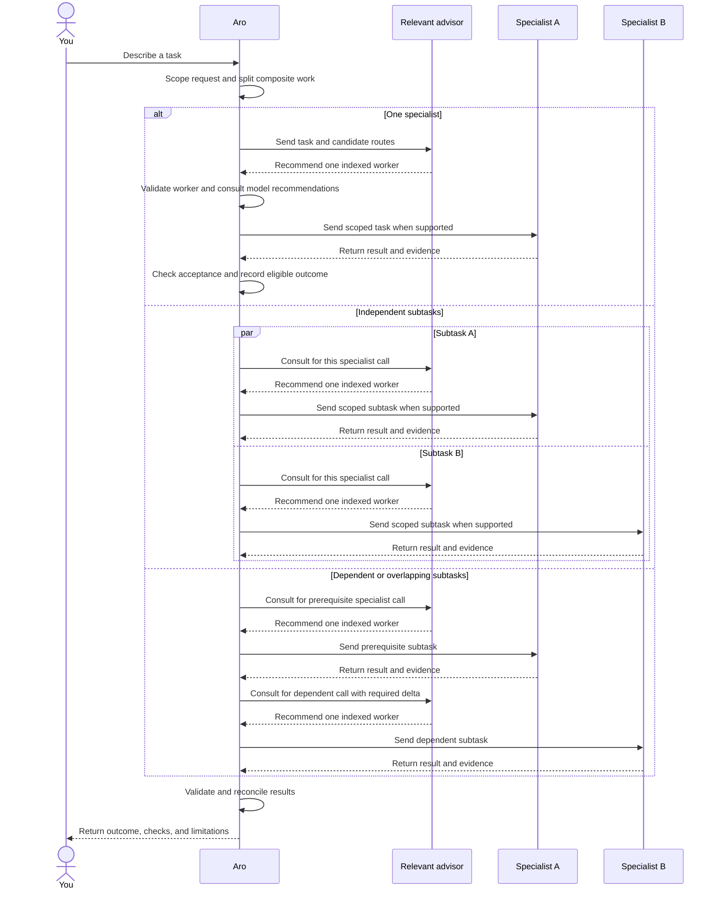

# Agent Catalog

Aro is the dispatcher. Advisors select a worker without tools; workers do not delegate. Agent names and role boundaries are preserved from the source council.

Workers keep one skill-loading policy per consuming agent and load required skills from runtime-discovered locations, not paths guessed from the target workspace. Missing procedures return to Aro for resolution. Read-only assessment workers return complete content; Aro arranges advisor-selected documentation persistence and verifies saved artifacts without granting analysts edit tools.

## Aro Routing

Aro consults the relevant advisor before every specialist call, even when the right specialist seems obvious. If an advisor cannot recommend a valid worker, Aro corrects the candidate scope or asks for clarification; it does not skip advisor selection.

Before each advisor and specialist call, Aro consults the profile-local learning tool for that call's role and task category, independently of the chat model. It considers the bounded shortlist, selected cloud/local scope and priority, and permitted exploration. A configured or fallback model must be eligible within that scope; if scope cannot be verified or no suitable model is available, Aro reports the limitation. Confirmed provider or model availability failures can trigger bounded re-queries with request-local exclusions; Aro does not repeat uncertain side effects or treat provider failures as model-quality failures. Advisor decisions are recorded only when correctness can be independently verified, not merely because the response is valid JSON. The requested model is not proof of runtime resolution; report resolution only when runtime telemetry confirms it. See [Aro Model Learning](../README.md#aro-model-learning-experimental) for inventory, privacy and limitations.

| Agent | Purpose |
| --- | --- |
| [AgentOptimizer](../agents/AgentOptimizer.agent.md) | Analyze and optimize a VS Code agent (its definition, tools, description/WHEN trigger, skills, and instructions) for the explicitly named target agent, or the active agent when no target was supplied. Definition files may be inside the open workspace. Invoke when an agent won't load, ignores instructions, fails to invoke tools/skills, has broken base-on-context features, shows slow, unexpected behavior, or routes tasks poorly. Used especially from remote SSH sessions where local skill files are not available.  |
| [Brainstorm](../agents/Brainstorm.agent.md) | Divergent thinking agent optimized for generating low-token architectural alternatives, edge-case evaluations, and code pattern options under strict local sandbox limits. |
| [BusinessKnowledgeAdvisor](../agents/BusinessKnowledgeAdvisor.agent.md) | Business-knowledge domain advisor for selecting specialists for needs, requirements, business rules, process analysis, enterprise knowledge maps and evidence-grounded impact questions. Returns a selection decision only. |
| [BusinessKnowledgeExpert](../agents/BusinessKnowledgeExpert.agent.md) | Professional evidence-grounded analysis of business needs, requirements and business logic from supplied code, policies, regulations, processes and data; produces detailed catalogues, enterprise knowledge maps, traceability/impact answers and explicit quality audits. |
| [CodeArchitectureExpert](../agents/CodeArchitectureExpert.agent.md) | Document current architecture as C4 views for an As-Is System Reference, or propose proportionate target architecture from supplied business/product evidence; define component/data/interface and trust contracts without implementation or approval. |
| [CodeBackendAdvisor](../agents/CodeBackendAdvisor.agent.md) | Backend selection advisor for API, framework, GraphQL/tRPC, and database work. Returns a decision only; never implements or delegates. |
| [CodeComfyUICustomNodeSpecialist](../agents/CodeComfyUICustomNodeSpecialist.agent.md) | Develop, review, debug, and test ComfyUI custom nodes and node packs. Covers Python node registration, V1/V3 APIs, IMAGE/MASK/LATENT tensor contracts, model/device handling, workflow integration, and JavaScript frontend extensions. |
| [CodeContextSchemaAuditor](../agents/CodeContextSchemaAuditor.agent.md) | Read-only audit of database/API schemas, internal component and external-system dependencies, configuration and environment constraints for design or an As-Is System Reference; returns evidence-linked boundaries and gaps. |
| [CodeDatabaseORMGenerator](../agents/CodeDatabaseORMGenerator.agent.md) | Specialized for database schema and ORM setup. Handles SQL/ORM scaffolding, migrations, indexes, constraints, connection pooling, seeding, and query patterns. Supports PostgreSQL, MySQL, SQLite, and MariaDB with SQLAlchemy (Python), Prisma (Node.js), Hibernate/JPA (Java), and Eloquent (PHP). |
| [CodeDesignSystemSpecialist](../agents/CodeDesignSystemSpecialist.agent.md) | Specialized for building shared UI component libraries and design systems. Creates reusable components, theming/tokens, state management patterns, and documentation. Supports React, Vue, and Angular component libraries with theming, prop types, and accessibility. |
| [CodeDomainAdvisor](../agents/CodeDomainAdvisor.agent.md) | Coding-domain selection advisor for product modernization, architecture, rebuild and cross-stack work. Returns a routing decision only; never implements code or invokes agents. |
| [CodeExpressSpecialist](../agents/CodeExpressSpecialist.agent.md) | Implement, review and debug Express APIs using existing repository conventions; scaffold only when initialization is requested. Covers routes, middleware, validation, authorization, error handling and persistence integration. |
| [CodeFastApiSpecialist](../agents/CodeFastApiSpecialist.agent.md) | Specialized for backend API scaffolding with FastAPI, Pydantic, SQLAlchemy, and pytest. Handles OpenAPI spec generation, dependency injection patterns, and async database setup. |
| [CodeFrameworkDiagnostician](../agents/CodeFrameworkDiagnostician.agent.md) | Local error parser and dependency validation expert configured to solve complex framework bugs without active web browsing tools. |
| [CodeFrontendAdvisor](../agents/CodeFrontendAdvisor.agent.md) | Frontend selection advisor for Next.js, Vite/React, or shared design-system work. Returns a decision only; never implements or delegates. |
| [CodeGeneralist](../agents/CodeGeneralist.agent.md) | Implement, review, debug, or refactor code when no framework or domain specialist fits. Follow the target repository's language, conventions, and tests; never scaffold an unrelated stack. |
| [CodeGraphQLTRPCAgent](../agents/CodeGraphQLTRPCAgent.agent.md) | Specialized for GraphQL API and tRPC scaffolding. Handles GraphQL schema (SDL), type definitions, resolvers, API design, and tRPC codegen patterns (Next.js). Supports Apollo Server, Hasura, and tRPC. |
| [CodeMockupWireframeSpecialist](../agents/CodeMockupWireframeSpecialist.agent.md) | Specialized in producing direct, readable mockups with Unicode box-drawing in Copilot Chat. Turns requirements into numbered node and screen layouts with concise design notes and no process narration. |
| [CodeNextJsSpecialist](../agents/CodeNextJsSpecialist.agent.md) | You are a specialist for Next.js applications, including responsive product UI, styling, routing, Server/Client Components, API routes, and modern TypeScript practices. |
| [CodeProductModernizationExpert](../agents/CodeProductModernizationExpert.agent.md) | Assess product features and modernization opportunities using supplied business evidence; propose keep/improve/replace/remove/add decisions, target workflows and detailed to-be requirements without implementing or approving scope. |
| [CodeQualityGuardrailReviewer](../agents/CodeQualityGuardrailReviewer.agent.md) | Independent read-only review of proposed specifications, designs and code changes against supplied requirements and repository evidence; reports unsupported claims, contract defects, risks and test gaps without fixing them. |
| [CodeReactViteSpecialist](../agents/CodeReactViteSpecialist.agent.md) | Generate and scaffold frontend projects built with TypeScript, React, and Vite. Invoke for application UI, responsive screen and CSS work, component architecture, state management (Redux/Zustand), build configuration, and testing setup.  |
| [CodeRebuildEngineer](../agents/CodeRebuildEngineer.agent.md) | Use for 'Build the As-Is System Reference for [repository]' or rebuild assessment. Coordinate and integrate a complete evidence-linked current-state reference, or supplied modernization/architecture reports, with an indexed resume point; no implementation or delegation. |
| [CodeSpringBootSpecialist](../agents/CodeSpringBootSpecialist.agent.md) | Implement, review and debug Spring Boot services using existing Maven/Gradle, layering, transaction and security conventions; scaffold only when initialization is requested. |
| [ContextSummarizer](../agents/ContextSummarizer.agent.md) | Produces a concise checkpoint summary when context pressure is observed or the user explicitly requests one. Does not modify chat history, trigger runtime compaction, or run on a fixed turn count. |
| [DocsGovernanceAdvisor](../agents/DocsGovernanceAdvisor.agent.md) | Documentation/governance specialist-selection advisor for ADR, documentation, GitHub, and web research workflows. Returns a routing decision only. |
| [GovArchitectureRecordsExpert](../agents/GovArchitectureRecordsExpert.agent.md) | Draft and maintain repository-native ADRs, RFCs, and architecture records. Preserve human decision authority; proposals are not approved decisions. No application implementation or delegation. |
| [GovDocumentationSuiteGenerator](../agents/GovDocumentationSuiteGenerator.agent.md) | Write documentation and READMEs; classify existing docs by Diataxis user need for an As-Is System Reference and faithfully export supplied architecture/business records with evidence and status. |
| [GovGitWorkflowAgent](../agents/GovGitWorkflowAgent.agent.md) | Manage Git branches, scoped commits, staging, pushes, pull requests, PR updates, reviews, merges, and branch cleanup. Use for commit/branch/PR management, ahead/behind checks, rebases, cherry-picks, and Git workflow recovery; not issue proposal planning or application implementation. |
| [GovGithubAgent](../agents/GovGithubAgent.agent.md) | Plan agent capabilities as proposals, manage GitHub issue triage, and file scoped issues or project items in the verified repository. Not for Git branches, commits, pushes, or pull-request lifecycle management; those belong to GovGitWorkflowAgent. |
| [GovOfficeDocumentGenerator](../agents/GovOfficeDocumentGenerator.agent.md) | Create and validate requested native PowerPoint (.pptx) and Visio (.vsdx) files from supplied content using locally available generation tools. |
| [GovPublicSourceResearchAgent](../agents/GovPublicSourceResearchAgent.agent.md) | Read-only public-source research via web/fetch or runtime-exposed search/discovery tools: current documentation, source verification, comparisons, and troubleshooting evidence. Fetches supplied public URLs directly. Returns cited findings, with no implementation. |
| [InfraAzureDevOpsAgent](../agents/InfraAzureDevOpsAgent.agent.md) | Read Azure DevOps work items, Azure Repos, pull requests, and wiki pages through the Azure DevOps MCP; apply changes only after explicit user confirmation. Not pipeline failure diagnosis, GitHub workflows, or cloud deployment. |
| [InfraCIDiagnostics](../agents/InfraCIDiagnostics.agent.md) | You are a specialist for diagnosing and fixing CI failures and GitHub Actions errors. When invoked, you determine why a job/PR failed (root cause), propose the minimal fix, and — when the user asks — apply it. You always present the diagnosis/fix as a proposal unless explicitly asked to apply it. |
| [InfraCloudDeploymentAgent](../agents/InfraCloudDeploymentAgent.agent.md) | Specialized for cross-cloud deployment and provisioning. Creates cloud-init scripts, deployment pipelines, container orchestration, and multi-cloud provisioning strategies (AWS/GCP/Azure). Supports Azure DevOps, GitHub Actions, and IaC-driven deployments. |
| [InfraDevContainerSpecialist](../agents/InfraDevContainerSpecialist.agent.md) | Manages VS Code dev container configurations, Dockerfile generation, and environment provisioning. Handles `.devcontainer` scaffolding, remote SSH setups, and container lifecycle. |
| [InfraDevOpsAdvisor](../agents/InfraDevOpsAdvisor.agent.md) | Infrastructure/DevOps advisor for local LLM inference, deployment, IaC, security, Kubernetes, tooling, and CI selection. Returns a decision only. |
| [InfraIaCGenerator](../agents/InfraIaCGenerator.agent.md) | Generate and validate repository-native Terraform, Pulumi, Bicep or ARM infrastructure for the verified provider. Preserve state, account scope, least privilege and stage-specific authorization; no automatic apply, publication or deployment. |
| [InfraKubernetesEngineer](../agents/InfraKubernetesEngineer.agent.md) | Specialized for Kubernetes cluster engineering: Helm/Kustomize manifests, cluster/operator definitions, AKS and other cluster-engine provisioning, RBAC/roles, Ingress and networking, and kubectl pod/namespace troubleshooting.  |
| [InfraLLMInferenceSpecialist](../agents/InfraLLMInferenceSpecialist.agent.md) | Diagnose and configure local LLM inference: Ollama, llama.cpp, GGUF, GPU offload, VRAM/KV-cache budgets, context limits, model loading, runtime compatibility, and controlled engine comparisons. Not Kubernetes ownership, generic CPU profiling, or application orchestration code. |
| [InfraMCPServerGenerator](../agents/InfraMCPServerGenerator.agent.md) | Specialized for Model Context Protocol server setup with full structure, configuration files, and client integration. Handles MCP server scaffolding, JSON-RPC protocol setup, and editor integration. |
| [InfraMonorepoManager](../agents/InfraMonorepoManager.agent.md) | Coordinate workspace packages, dependency graphs, version synchronization and affected builds; return publication and Git requirements through Orchestrator without publishing or tagging. |
| [InfraObservabilitySpecialist](../agents/InfraObservabilitySpecialist.agent.md) | Specialized for observability engineering. Creates error monitoring, structured logging, distributed tracing (OpenTelemetry), metrics dashboards, and alerting rules. Supports Application Insights, Azure Monitor, and Log Analytics. |
| [InfraPerformanceProfiler](../agents/InfraPerformanceProfiler.agent.md) | Evidence-based Python/Node CPU and memory profiling with OS, runtime-version and installed-profiler checks. Use for application bottlenecks and regressions; GPU model capacity and engine comparisons belong to the inference specialist. |
| [InfraReleaseManager](../agents/InfraReleaseManager.agent.md) | Prepare versions, changelogs, release notes, and artifact publication with stage-specific authorization. Return Git mutations to Orchestrator for GovGitWorkflowAgent; preparation never authorizes publication or deployment. |
| [InfraSecurityAuthAgent](../agents/InfraSecurityAuthAgent.agent.md) | Provider-neutral authentication, authorization, RBAC, secrets and trust design. Use for GitHub App/OIDC, AWS IAM/Cognito, Azure identity, application authorization, or Kubernetes Secret delivery; diagnose the evidenced boundary without automatic permission expansion. |
| [InfraTestInfrastructureGenerator](../agents/InfraTestInfrastructureGenerator.agent.md) | Generate test suites, fixtures, mocks, coverage and testing-specific CI gates; run scoped tests only when execution is authorized. Failing-job diagnosis and deployment stages remain with their dedicated workers. |
| [MultiLanguageBuilder](../agents/MultiLanguageBuilder.agent.md) | Handles polyglot builds across Python/Node.js/TypeScript with polyglot package management (pip/pnpm/yarn). Manages workspace isolation, version pinning, and cross-language dependency resolution. |
| [ProjectAssessmentAdvisor](../agents/ProjectAssessmentAdvisor.agent.md) | Selects one read-only evidence collector by source family, or the cross-source analysis worker, for a project assessment. Returns a decision only. |
| [ProjectAssessmentExpert](../agents/ProjectAssessmentExpert.agent.md) | Analyzes supplied evidence records across documentation, code, architecture, requirements, and delivery practice, keeping conflicts and gaps visible. Tool-free: analyzes only the supplied evidence records. No writes. |
| [ProjectEvidenceAzureDevOpsCollector](../agents/ProjectEvidenceAzureDevOpsCollector.agent.md) | Collects read-only Azure DevOps evidence for projects, teams, and code, wiki, work item, or commit search. No tools are bound until debug verifies exact names and read-only enforcement; grouped categories are BLOCKED pending debug. Distinct from InfraAzureDevOpsAgent, which is read and write. |
| [ProjectEvidenceGitHubCollector](../agents/ProjectEvidenceGitHubCollector.agent.md) | Collects read-only GitHub code scanning alerts for a project assessment. No tools are bound until debug verifies the runtime names; Actions, Projects, automation, repository, commit, issue, and PR tools are BLOCKED pending debug. Secret scanning is excluded. |
| [ProjectEvidenceLocalRepoCollector](../agents/ProjectEvidenceLocalRepoCollector.agent.md) | Collects local target-repository evidence using read and search only. Branch, commit, and dirty status stay unknown unless evidenced. |
| [ProjectEvidenceM365Collector](../agents/ProjectEvidenceM365Collector.agent.md) | Teams, Planner, and OneDrive evidence collector with no tools bound. BLOCKED until distinct read tools are debug-bound and preauthorized. Reports authorization failures as blocked. |
| [ProjectEvidenceSharePointCollector](../agents/ProjectEvidenceSharePointCollector.agent.md) | Collects read-only SharePoint documents, libraries, lists, and site metadata. No tools are bound: four WorkIQ read tools are PENDING. BLOCKED until the binding and preauthorization are debug-verified. Reports authorization failures as blocked. |
| [Aro](../agents/Aro.agent.md) | Orchestrator for advisor-led specialist selection, scoped dispatch, model selection, sequencing, and result synthesis. Never acts as the worker. |
| [UtilityAdvisor](../agents/UtilityAdvisor.agent.md) | Utility specialist-selection advisor for agent diagnostics, divergent brainstorming, and checkpoint summaries. Returns a decision only. |
